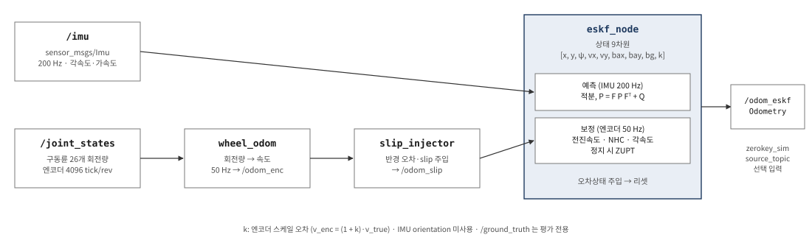

# 모바일 로봇 자기위치 공유 브리지 (CNU → JW, GET_CUR_MPOS)

- 작성: 충남대학교 자율운항시스템공학과 윤원근 교수
- 저장소: <https://github.com/wkyouncnu/smartpainting-cnu-jw-bridge>
- 매뉴얼(PDF): [docs/manual/CNU_JW_Bridge_Manual.pdf](docs/manual/CNU_JW_Bridge_Manual.pdf)


*그림 1. 시스템 구성*

---

## 목차

1. [개요](#1-개요)
2. [통신 구조](#2-통신-구조)
3. [위치추정 (ESKF)](#3-위치추정-eskf)
4. [설치](#4-설치)
5. [실행](#5-실행)
6. [프로그램별 입출력](#6-프로그램별-입출력)
7. [검증](#7-검증)
8. [실장비 적용](#8-실장비-적용)
9. [문제 해결](#9-문제-해결)
10. [확인 필요 사항](#10-확인-필요-사항)

---

# 1. 개요

## 1-1. 목적

- 선박 블록 내부(블라스팅 환경) 주행 모바일 로봇의 위치 X·Y·Z 및 헤딩 ψ(RZ)를 주원테크놀러지(JW) 통합제어기로 전송
- 통신 사양서 Rev1.5 의 `GET_CUR_MPOS` 응답 형식 적용
- Windows PC 1대(WSL2)에서 Gazebo 시뮬레이션 기반 송신·수신·검증 환경 구성

## 1-2. 주요 사양

| 항목 | 내용 |
| --- | --- |
| 전송 값 | X, Y, Z [mm], RZ [deg] (4개) |
| 전송 방식 | TCP, ASCII, 포트 5010 |
| 역할 | CN(충남대) = TCP 서버, JW = TCP 클라이언트 (요청-응답) |
| 위치 소스 | 현재: Gazebo 참값 → ZeroKey 토픽 모사 / 실기: ZeroKey RTLS (동일 토픽, 코드 변경 없음) |
| 자세 처리 | 쿼터니언 → 헤딩(yaw)만 사용, Roll·Pitch 미전송 |
| 속도 | `/zerokey/vel` 발행, `GET_CUR_MPOS` 미사용 |
| 실행 환경 | Windows 10/11 + WSL2 Ubuntu 24.04, ROS 2 Jazzy, Gazebo Harmonic |

## 1-3. ZeroKey 토픽 정의

- 출처: 실기 Simulink 모델 `Tracked_UGV_ZeroKey_XsensIMU.slx` 의 ROS 2 Subscribe 블록

| Simulink 블록 | 토픽 | 메시지 타입 | QoS |
| --- | --- | --- | --- |
| Subscribe9 | `/zerokey/position` | `geometry_msgs/PointStamped` | Reliable · Volatile · KeepLast 10 |
| Subscribe12 | `/zerokey/orientation` | `geometry_msgs/QuaternionStamped` | 〃 |
| Subscribe10 | `/zerokey/vel` | `geometry_msgs/TwistStamped` | 〃 |
| Subscribe11 | `/imu/data` | `sensor_msgs/Imu` (Xsens, 본 브리지 미사용) | 〃 |

## 1-4. 저장소 구성

```
smartpainting-cnu-jw-bridge/
├── install.sh                  일괄 설치 (ROS 2 + Gazebo + 빌드 + bashrc)
├── src/
│   ├── sp_cnu_bridge/          위치 브리지 패키지 (본 과제 개발)
│   │   ├── sp_cnu_bridge/      protocol · zerokey_sim · mpos_server · jw_mock_client · verify
│   │   ├── config/bridge.yaml  파라미터 (포트, 단위, 자릿수, 토픽)
│   │   ├── launch/             bridge.launch.py, bridge_demo.launch.py
│   │   └── test/               단위 시험 15건
│   ├── sp_localization/        IMU + 엔코더 ESKF 위치추정
│   ├── sp_gazebo/              월드 · 런치 · 로봇 구동 스크립트
│   └── sp_description/         로봇 URDF · 메시
├── jw_receiver/                JW 측 수신 검증기 (ROS 불필요)
├── docs/                       매뉴얼 PDF, 그림, 시뮬레이션 인수인계 문서(HANDOVER.md)
├── tools/docs/                 README → PDF 변환 도구
└── cad/                        원본 STEP 도면
```

---

# 2. 통신 구조

## 2-1. ROS 2 토픽


*그림 2. ROS 2 토픽 흐름*

| 토픽 | 메시지 타입 | 발행 → 구독 | 주기 | 내용 |
| --- | --- | --- | --- | --- |
| `/ground_truth` | `nav_msgs/Odometry` | Gazebo → `zerokey_sim` | 50 Hz (sim time) | 바퀴부 중심 참 위치 [m]·자세·속도 |
| `/zerokey/position` | `geometry_msgs/PointStamped` | `zerokey_sim` → `mpos_server` | 50 Hz | `point.x/y/z` [m] |
| `/zerokey/orientation` | `geometry_msgs/QuaternionStamped` | `zerokey_sim` → `mpos_server` | 50 Hz | 쿼터니언 |
| `/zerokey/vel` | `geometry_msgs/TwistStamped` | `zerokey_sim` → (없음) | 50 Hz | 월드 좌표 속도 [m/s] |
| `/cnu_bridge/mpos` | `geometry_msgs/PoseStamped` | `mpos_server` → 확인용 | 10 Hz | JW 송신값과 동일 [m] |
| `/cnu_bridge/heading_deg` | `std_msgs/Float64` | `mpos_server` → 확인용 | 10 Hz | 헤딩 [deg] |
| `/cnu_bridge/last_tx` | `std_msgs/String` | `mpos_server` → 확인용 | 요청마다 | 송신 TCP 프레임 원문 |

- `/ground_truth`: sim time 기준 50 Hz, 실시간 비율 10–30 % 이므로 wall clock 기준 더 느림
- `/zerokey/*`: wall clock 50 Hz 고정 발행 (신규 참값 미수신 시 직전 값 재발행)
- TCP: JW 요청 주기 추종, 사양서 정상 운용 주기 100 Hz


*그림 3. rqt_graph (실행 중 시스템, 브리지 부분)*


*그림 4. 토픽 주기 및 내용 확인*

## 2-2. TCP 시퀀스


*그림 5. TCP 시퀀스 (사양서 기동 절차 + 정상 운용)*

## 2-3. GET_CUR_MPOS 프레임


*그림 6. GET_CUR_MPOS 응답 프레임 구조*

| 구분 | 형식 | 예 |
| --- | --- | --- |
| 요청 (JW → CN) | `$JW,<SEQ>,1,GET_CUR_MPOS,0\r\n` | `$JW,5,1,GET_CUR_MPOS,0` |
| 응답 (CN → JW) | `$CN,<SEQ>,1,GET_CUR_MPOS,4,<X>,<Y>,<Z>,<RZ>\r\n` | `$CN,5,1,GET_CUR_MPOS,4,-2680,-877,520,0.00` |

| 필드 | 출처 | 변환 | 기본 형식 |
| --- | --- | --- | --- |
| X, Y, Z | `/zerokey/position` [m] | × 1000, 반올림 | mm 정수 |
| RZ | `/zerokey/orientation` | ψ = atan2(2(wz+xy), 1−2(y²+z²)) → deg | 소수 2자리, [−180, 180), +X 기준 반시계 + |

## 2-4. 지원 명령

- 주 기능: `GET_CUR_MPOS`
- 기타 명령: 사양서 기동 절차(2-5) 진행에 필요한 최소 응답

| 명령 | 응답 데이터 | 동작 |
| --- | --- | --- |
| `GET_VERSION` | `100` | 프로토콜 1.00 |
| `GET_LOCALIZATION_STATUS` | `상태, 0` | 0 = 위치 미수신 / 1 = 300 ms 초과 미갱신 / 2 = 정상 |
| `REQ_ORIGIN_INIT` | `1, 0` | 항상 반영 완료 (원점 오프셋 계산 미구현) |
| **`GET_CUR_MPOS`** | **`X, Y, Z, RZ`** | 최신 위치·헤딩 |
| `GET_CUR_MDELTA` | `dX, dY, dZ, dRZ` | 직전 `GET_CUR_MDELTA` 이후 변화량 |
| `SET_ORG_POS_OFFS` · `SET_CUR_APOS` · `SET_CUR_AVEL` · `SET_ROLLER_ENC` | 없음 | 수신 확인만 |
| 기타 | 응답 없음 | F 개수만큼 건너뜀, 로그 기록 |

- 한 프레임 다중 블록(N > 1): 블록별 처리 후 한 줄로 응답

---

# 3. 위치추정 (ESKF)



*그림 7. ESKF 위치추정 구성 (`sp_localization`)*

## 3-1. 구성

- 패키지: `src/sp_localization` (상세: [docs/localization.md](docs/localization.md))
- 센서: IMU 200 Hz (바퀴부 중심), 구동륜 엔코더 26개 (4096 tick/rev)
- 상태(9차원): 위치 x, y · 헤딩 ψ · 속도 vx, vy · 가속도 바이어스 bax, bay · 자이로 바이어스 bg · 엔코더 스케일 k

| 단계 | 입력 | 처리 |
| --- | --- | --- |
| 예측 | IMU 각속도·가속도, 200 Hz | 관성 적분, 오차 공분산 전파 P = F P Fᵀ + Q |
| 보정 | 엔코더 속도, 50 Hz | 전진속도 · 측면속도 0 (NHC) · 엔코더 각속도 관측, 정지 시 ZUPT |
| 주입·리셋 | 오차상태 | 실제상태에 더한 후 0 으로 초기화 |

- 엔코더 위치(누적값)는 관측에 미사용, 순간 속도만 사용
- Gazebo IMU 의 orientation(참자세) 미사용
- `/ground_truth` 는 평가 전용
- 잭업 회전 구간: 자이로 회전 감지 시 2 s 동안 엔코더 각속도 관측 제외 (회전량 흡수 방지)

## 3-2. 토픽

| 토픽 | 타입 | 내용 |
| --- | --- | --- |
| `/imu` | `sensor_msgs/Imu` | 200 Hz |
| `/joint_states` | `sensor_msgs/JointState` | 구동륜 회전량 (엔코더 원시값) |
| `/odom_enc` | `nav_msgs/Odometry` | 휠 오도메트리, 50 Hz |
| `/odom_slip` | `nav_msgs/Odometry` | slip 주입 휠 오도메트리 (ESKF 입력) |
| `/odom_eskf` | `nav_msgs/Odometry` | ESKF 추정 결과 |

## 3-3. 주요 결과 (시뮬레이션)

| 항목 | 결과 |
| --- | --- |
| 위치 오차 최대 (엔코더 각속도 관측 포함) | 7 mm |
| 헤딩 오차 | −0.05° |
| 3 왕복 6.1 m 주행 후 위치 오차 최대 (NHC σ 0.005 m/s) | 23 mm |
| 엔코더 스케일 k 추정 (참값 +4 %) | +4.05 % (σ 0.38 %) |

## 3-4. 브리지 연동

- ESKF 추정값을 JW 로 전송 시 `zerokey_sim` 입력을 `/odom_eskf` 로 변경

```bash
ros2 launch sp_localization eskf.launch.py
ros2 launch sp_cnu_bridge bridge.launch.py source_topic:=/odom_eskf
```

---

# 4. 설치

- 요구 사항: Windows 10 22H2 이상 또는 Windows 11, 인터넷, 디스크 여유 15 GB
- 소요 시간: 30–60분 (대부분 패키지 내려받기)

## 4-1. WSL2 및 Ubuntu 24.04

- 관리자 권한 PowerShell 에서 실행

```powershell
wsl --install -d Ubuntu-24.04
```

- 재부팅 후 Ubuntu 사용자 이름·암호 설정 (암호는 `sudo` 에 사용)
- 확인: `wsl -l -v` 결과 `Ubuntu-24.04 ... 2` (VERSION 2)
- Ubuntu 24.04 필수 (ROS 2 Jazzy apt 지원 버전, 22.04 에서는 `install.sh` 1단계 중단)

## 4-2. 저장소 복제

```bash
sudo apt update && sudo apt install -y git
mkdir -p ~/ws && cd ~/ws
git clone https://github.com/wkyouncnu/smartpainting-cnu-jw-bridge.git
cd smartpainting-cnu-jw-bridge
```

- 복제 위치: Linux 홈(`~/ws`). Windows 드라이브(`/mnt/c`, `/mnt/d`)는 빌드 속도 저하·권한 오류 발생

## 4-3. 일괄 설치 (`install.sh`)

```bash
bash install.sh
```

| 단계 | 내용 | 소요 시간 |
| --- | --- | --- |
| [1/7] 환경 확인 | Ubuntu 24.04, WSL, 인터넷 연결 | 수 초 |
| [2/7] 로케일 | UTF-8 설정 | 30초 |
| [3/7] ROS 2 저장소 | `ros2-apt-source` 등록 | 30초 |
| [4/7] 패키지 설치 | ROS 2 Jazzy desktop, Gazebo Harmonic, ros_gz, rqt 등 (3–4 GB) | 10–30분 |
| [5/7] rosdep | 의존성 데이터베이스 | 1분 |
| [6/7] 빌드 | `colcon build --symlink-install` (sp_* 4개 패키지) | 1분 |
| [7/7] bashrc | ROS 환경 자동 적용 등록 (재실행 시 현재 경로로 갱신) | 즉시 |

- 옵션: `--system-only` (1–5단계), `--build-only` (6–7단계)
- 실패 시: 실패 단계명 및 기록 마지막 15줄 출력 → [9-1](#9-1-설치) 참조 후 재실행 (완료 단계는 건너뜀)
- 전체 기록: `~/sp_install.log`
- 설치 후 Ubuntu 창 재실행 (bashrc 적용)


*그림 8. install.sh 실행 결과*

---

# 5. 실행

## 5-1. 시뮬레이션 및 브리지 기동 (터미널 1)

```bash
ros2 launch sp_cnu_bridge bridge_demo.launch.py
```

- Gazebo 기동 후 3 s 뒤 `zerokey_sim`, `mpos_server` 기동
- 정상 기동 로그

```text
[zerokey_sim]: ZeroKey 모사 시작: /ground_truth → /zerokey/{position,orientation,vel} @ 50 Hz ...
[mpos_server]: TCP 서버 대기 0.0.0.0:5010  (단위 X·Y·Z ×1000, 소수 0자리 / RZ deg 소수 2자리)
```

| 옵션 | 용도 |
| --- | --- |
| `gui:=false` | Gazebo 창 없이 실행 (검증 시 권장) |
| `software_render:=true` | Gazebo 화면 깨짐 시 |
| `rviz:=true` | RViz 동시 실행 |
| `port:=5011` | TCP 포트 변경 |


*그림 9. Gazebo 실행 화면 (선박 블록 내부 크롤러 로봇)*

## 5-2. JW 모의 클라이언트 (터미널 2)

```bash
ros2 run sp_cnu_bridge jw_mock_client          # --raw: 송수신 프레임 원문 출력
```

- 사양서 순서: `GET_VERSION` → `GET_LOCALIZATION_STATUS` → `REQ_ORIGIN_INIT` → `GET_CUR_MPOS` 100 Hz
- 0.2 s 간격 수신 값 출력


*그림 10. jw_mock_client 실행 결과*

## 5-3. 로봇 구동 (선택, 터미널 3)

```bash
ros2 run sp_gazebo patrol.py           # ㅁ자 순회: 직진 → 잭업 90° 회전 → 횡이동 → 복귀
ros2 run sp_gazebo maneuver.py -d 0.5  # 전진 → 덱 회전 → 착지
```

## 5-4. 종료

- 각 터미널 `Ctrl+C` 후 프로세스 정리 (미실행 시 다음 기동에서 포트 5010 점유 오류)

```bash
ros2 run sp_gazebo cleanup.sh          # 정상: "남은 프로세스: 0"
```

---

# 6. 프로그램별 입출력

## 6-1. 요약

| 프로그램 | 실행 | 입력 | 출력 | ROS |
| --- | --- | --- | --- | --- |
| `zerokey_sim` | `ros2 run sp_cnu_bridge zerokey_sim` | `/ground_truth` | `/zerokey/position` · `orientation` · `vel` | 필요 |
| `mpos_server` | `ros2 run sp_cnu_bridge mpos_server` | `/zerokey/position` · `orientation`, TCP 요청 | TCP 응답, `/cnu_bridge/*` | 필요 |
| `jw_mock_client` | `ros2 run sp_cnu_bridge jw_mock_client` | TCP 응답 | 콘솔 표, CSV(선택) | 불필요 |
| `verify` | `ros2 run sp_cnu_bridge verify` | `/zerokey/*`, `/ground_truth`, TCP 응답 | 오차 표, PNG, 종료 코드 | 필요 |
| `jw_receiver_gui` | `run_receiver.bat` | TCP 응답 | GUI, 판정, CSV(선택) | 불필요 |

## 6-2. `zerokey_sim` 파라미터

| 파라미터 | 기본값 | 설명 |
| --- | --- | --- |
| `source_topic` | `/ground_truth` | 입력 Odometry 토픽 (ESKF 사용 시 `/odom_eskf`) |
| `rate_hz` | `50.0` | 발행 주기 |
| `frame_id` | `zerokey` | header.frame_id |
| `pos_noise_std` | `0.0` m | 위치 가우시안 잡음 (ZeroKey 모사 시 0.01–0.03) |
| `yaw_noise_std_deg` | `0.0` deg | 헤딩 잡음 |

- `/zerokey/vel`: Odometry 몸체 속도를 월드 좌표로 변환하여 발행

## 6-3. `mpos_server` 파라미터

| 파라미터 | 기본값 | 설명 |
| --- | --- | --- |
| `host` / `port` | `0.0.0.0` / `5010` | 대기 주소 (다중 클라이언트 허용) |
| `position_topic` / `orientation_topic` | `/zerokey/position` / `/zerokey/orientation` | 입력 토픽 |
| `pos_scale` | `1000.0` | m → mm (m 단위 전송 시 1.0) |
| `pos_decimals` | `0` | X·Y·Z 소수 자릿수 |
| `yaw_decimals` | `2` | RZ 소수 자릿수 |
| `stale_timeout_s` | `0.3` | 미갱신 판정 시간 (초과 시 STATUS = 1) |
| `log_every_n` | `100` | `GET_CUR_MPOS` 로그 간격 (100 Hz 기준 1 s) |

## 6-4. 수정 위치

| 변경 항목 | 수정 파일 | 재빌드 |
| --- | --- | --- |
| 포트, 단위, 소수 자릿수 | `src/sp_cnu_bridge/config/bridge.yaml` | 불필요 (노드 재시작) |
| ZeroKey 토픽 이름 | `bridge.yaml` 의 `position_topic`, `orientation_topic` | 불필요 |
| 위치 소스 (참값 ↔ ESKF) | 실행 인자 `source_topic:=/odom_eskf` | 불필요 |
| 헤딩 정의 (북 기준, 시계 방향 등) | `protocol.py` 의 `mpos_fields()` + 단위 시험 | 불필요 |
| 명령 추가 | `mpos_server.py` 의 `handle_block()` | 불필요 |
| 실행 파일 추가 | `setup.py` 의 `console_scripts` | 필요 (`colcon build`) |

---

# 7. 검증

## 7-1. 검증 항목

| 구분 | 실행 | 대상 | 합격 기준 |
| --- | --- | --- | --- |
| 단위 시험 | `python3 -m pytest src/sp_cnu_bridge/test` | 프레임 생성·해석, 쿼터니언 변환, 반올림 | 15 passed |
| ROS 종단 시험 | `ros2 run sp_cnu_bridge verify` | TCP 응답 vs 브리지 입력·Gazebo 참값 | 일치율 ≥ 99 %, 응답률 ≥ 99 %, 지연 < 100 ms |
| JW 수신 시험 | `jw_receiver/run_receiver.bat` | 수신 프레임 형식·SEQ·값·주기 | 7개 항목 합격 |

## 7-2. 단위 시험

```bash
cd ~/ws/smartpainting-cnu-jw-bridge
python3 -m pytest src/sp_cnu_bridge/test -v
```

- 사양서 2-4-5 예시 `$CN,5,1,GET_CUR_MPOS,4,1251,842,0,45` 생성 일치
- 다중 블록, 미지원 명령 건너뛰기, 불완전 프레임, 쿼터니언 → 헤딩(0, ±90, ±179°), −0.00 처리


*그림 11. 단위 시험 결과*

## 7-3. ROS 종단 시험

```bash
ros2 run sp_gazebo patrol.py &
ros2 run sp_cnu_bridge verify --ros-args -p duration:=60.0
```

- 방법: TCP `GET_CUR_MPOS` 100 Hz 요청, 브리지 입력(`/zerokey/*`)·참값(`/ground_truth`) 수신 시각 기록 후 비교

| 오차 | 비교 대상 | 확인 내용 | 용도 |
| --- | --- | --- | --- |
| ① 브리지 정확성 | 응답 직전 100 ms 동안 유효한 `/zerokey` 입력 | 변환(m→mm, 쿼터니언→ψ)·전송 중 값 변형 여부 | 합격 판정 |
| ② 참값 대비 | 응답 시점 최신 `/ground_truth` | 센서 모사 단계 포함 최신성 | 참고 |

| 판정 항목 | 기준 | 근거 |
| --- | --- | --- |
| 일치율 | ≥ 99 % | ① 오차 위치 ≤ 1 mm (mm 반올림 ±0.5), 헤딩 ≤ 0.1° 인 응답 비율 |
| 응답률 | ≥ 99 % | 요청 대비 정상 응답 |
| 응답 지연 최대 | < 100 ms | 사양서 응답 시한 |

- 기준 변경 파라미터: `pos_tol_mm`, `yaw_tol_deg`, `match_window_ms`
- 시험 조건: patrol 1회 (직진 1.2 m, 횡이동 0.845 m, 90° 회전 2회), 430 s, 응답 43 000건

| 항목 | 결과 |
| --- | --- |
| ① 일치율 | 100.00 % (최대 0.70 mm, 0.005°) |
| 통신 | 응답률 100 %, 지연 평균 0.24 ms / 최대 3.5 ms |
| ② 참값 대비 | RMS 12 mm · 1.2°, 최대 236 mm · 20° |


*그림 12. 종단 시험 결과*


*그림 13. 종단 시험 그래프 (XY 궤적, X·Y, 헤딩, 오차: 진한 선 ① / 연한 선 ②)*

- ② 참값 대비 오차의 순간 최대값 원인
  - `zerokey_sim` 50 Hz 재샘플링 지연 (최대 약 20 ms)
  - WSL CPU 부하 시 `zerokey_sim` 일시 정지 (입력 간격 최대 1.8 s), `/ground_truth` 수신 간격 최대 0.3 s
  - 잭업·회전 중 정지 발생 시 오차 증가, 발생 위치는 실행마다 상이
- 실장비: 센서 모사 단계가 ZeroKey 갱신 주기로 대체, ① 기준으로 판정
- 오차 감소: `gui:=false` 실행, 타 프로그램 종료

## 7-4. JW 수신 검증기

- 용도: JW 측에서 ROS·Ubuntu 없이 X·Y·Z·ψ 수신 확인
- 요구 사항: Python 3.8 이상 (표준 라이브러리만 사용)
- 배포: `jw_receiver/` 폴더 복사

| 실행 | 명령 |
| --- | --- |
| GUI | `run_receiver.bat` 실행 → IP·포트 확인 → 연결/수신 시작 |
| 서버 지정 | `python jw_receiver_gui.py --host 192.168.0.10 --port 5010` |
| 콘솔 판정 | `python jw_receiver_gui.py --nogui --duration 20` |
| 수신 기록 | `python jw_receiver_gui.py --csv rx_log.csv` |
| 기동 절차 생략 | `python jw_receiver_gui.py --no-handshake` |

| # | 판정 항목 | 기준 |
| --- | --- | --- |
| 1 | 프레임 형식 | `$CN` 시작, N = 1, CMD = `GET_CUR_MPOS`, F = 4, `\r\n` 종료, 필드 9개 |
| 2 | SEQ 일치 | 응답 SEQ = 요청 SEQ |
| 3 | 값 해석 | X·Y·Z·RZ 숫자 |
| 4 | 헤딩 범위 | −180 ≤ RZ < 180 |
| 5 | 응답 지연 | 전 응답 100 ms 이내 |
| 6 | 수신 주기 | 요청 주기의 90 % 이상 |
| 7 | 통신 두절 | 1 s 이상 무응답 없음 |

- 50건 수신 후 판정 시작, 1회 실패 시 해당 항목 불합격 유지
- Windows 실측 주기 약 95 Hz (Windows `time.sleep` 해상도 영향, 기준 90 % 반영)


*그림 14. JW 수신 검증기 (Gazebo 로봇 주행 중 수신)*


*그림 15. JW 수신 검증기 콘솔 모드 (Windows → WSL 서버)*

## 7-5. 정상 동작 판정표

| # | 확인 위치 | 정상 상태 |
| --- | --- | --- |
| 1 | `install.sh` | `설치 끝.`, `[OK] sp_cnu_bridge 패키지 보임` |
| 2 | 터미널 1 | `TCP 서버 대기 0.0.0.0:5010`, 5 s 마다 `발행 250 회` |
| 3 | `ros2 topic hz /zerokey/position` | `average rate: 50.0` |
| 4 | `jw_mock_client` | STATUS 2, ORIGIN_INIT 1, 실측 약 100 Hz, 지연 < 1 ms |
| 5 | 로봇 정지 (스폰 위치) | X ≈ −2680, Y ≈ −877, Z ≈ 520 mm, RZ ≈ 0.00 |
| 6 | `verify` | `최종: ✔ 전부 합격` |
| 7 | JW 수신 검증기 | `✔ 합격 — 정상 수신`, 7개 항목 합격 |

---

# 8. 실장비 적용

## 8-1. ZeroKey 연결

- 조건: ZeroKey 드라이버가 `/zerokey/position`, `/zerokey/orientation` 동일 타입 발행
- 실행: 센서 모사 비활성

```bash
ros2 launch sp_cnu_bridge bridge.launch.py use_zerokey_sim:=false
```

- 확인 항목: 발행 주기, 위치 단위(m), ZeroKey 좌표계 +X 와 블록 좌표 +X 일치 (헤딩 0° 방향)

## 8-2. 외부 PC(JW 통합제어기) 접속

- 동일 PC: `127.0.0.1:5010` 직접 접속
- 외부 PC: WSL2 NAT 로 인해 아래 중 하나 설정 필요

| 방법 | 설정 |
| --- | --- |
| A. 미러 네트워킹 (Windows 11 22H2 이상, 권장) | `%USERPROFILE%\.wslconfig` 에 `[wsl2]` / `networkingMode=mirrored` 작성 후 `wsl --shutdown` |
| B. 포트 포워딩 | 관리자 PowerShell, WSL 재시작으로 IP 변경 시 재설정 |

```powershell
# 방법 B
$wsl = (wsl -d Ubuntu-24.04 hostname -I).Trim().Split(" ")[0]
netsh interface portproxy add v4tov4 listenport=5010 listenaddress=0.0.0.0 connectport=5010 connectaddress=$wsl
# 방법 A·B 공통: 방화벽 허용
New-NetFirewallRule -DisplayName "CNU MPOS 5010" -Direction Inbound -Protocol TCP -LocalPort 5010 -Action Allow
```

- 접속 확인: JW PC 에서 `python jw_receiver_gui.py --host <Windows PC IP>`

---

# 9. 문제 해결

## 9-1. 설치

| 단계 / 메시지 | 원인 | 조치 |
| --- | --- | --- |
| `[1/7] Ubuntu 24.04 (noble) 이 아닙니다` | Ubuntu 버전 불일치 | `wsl --install -d Ubuntu-24.04` 후 해당 창에서 재실행 |
| `[1/7] packages.ros.org 에 접속할 수 없습니다` | 인터넷·프록시·DNS | `ping -c 3 8.8.8.8` 확인, 프록시 환경 시 `export https_proxy=...` |
| `sudo: 3 incorrect password attempts` | Ubuntu 암호 오류 | `wsl -d Ubuntu-24.04 -u root passwd <사용자>` |
| `[3/7] GitHub API 응답 없음` | API 호출 제한·일시 장애 | 수 분 후 재실행 |
| `[4/7] Could not get lock /var/lib/dpkg/lock` | 자동 업데이트 실행 중 | 대기 후 재실행 |
| `[4/7] Unable to locate package ros-jazzy-...` | ROS 2 저장소 등록 실패 | `sudo dpkg -r ros2-apt-source` 후 재실행 |
| `[4/7] Hash Sum mismatch` | 네트워크 불안정 | 재실행 |
| `[4/7] No space left on device` | 디스크 부족 | C: 여유 15 GB 이상 확보 |
| `[6/7]` 빌드 실패 | `~/sp_install.log` 의 `Failed` 확인 | `rm -rf build install log` 후 `bash install.sh --build-only` |
| `[주의] 저장소가 Windows 드라이브에 있습니다` | `/mnt/c`, `/mnt/d` 에 복제 | `~/ws` 에 재복제 |

## 9-2. 실행

| 증상 | 원인 | 조치 |
| --- | --- | --- |
| `Package 'sp_cnu_bridge' not found` | 환경 미적용, 빌드 전 | 터미널 재실행 또는 `source ~/ws/smartpainting-cnu-jw-bridge/install/setup.bash` |
| `포트 5010 를 열 수 없다 (Address already in use)` | 이전 `mpos_server` 잔류 | `ros2 run sp_gazebo cleanup.sh`, 잔류 시 `ss -ltnp \| grep 5010` → `kill -9 <PID>` |
| 노드 목록·rqt_graph 일부 누락 | `cleanup.sh` 후 ROS 데몬 미갱신 | `ros2 daemon stop; ros2 daemon start` |
| Gazebo 화면 깨짐 | WSLg GPU 가속 문제 | `software_render:=true` |
| Gazebo 실시간 비율 10–30 % | 다수 바퀴 접촉 모델 | 정상, 검증 시 `gui:=false` |
| `/ground_truth 가 안 들어온다` 경고 | Gazebo 기동 전, 스폰 실패 | 30 s 대기, `ros2 topic list \| grep ground_truth` |
| `jw_mock_client` 접속 재시도 반복 | 서버 미기동, 포트 불일치 | 터미널 1 의 `TCP 서버 대기` 로그 확인 |
| `GET_LOCALIZATION_STATUS 0` 유지 | `/zerokey/*` 미수신 | `ros2 topic hz /zerokey/position` |
| `GET_LOCALIZATION_STATUS 1` 반복 | 300 ms 초과 미갱신 | 센서 확인, 필요 시 `stale_timeout_s` 조정 |
| Windows 에서 `127.0.0.1:5010` 접속 거부 | WSL localhost 포워딩 비활성 | `wsl --shutdown` 후 재시작, `.wslconfig` 에 `localhostForwarding=true` |
| 외부 PC 접속 불가 | WSL NAT, 방화벽 | [8-2](#8-2-외부-pcjw-통합제어기-접속) |
| `run_receiver.bat` 즉시 종료 | Python 미설치 | Python 3.8 이상 설치 (Add to PATH 선택) |

- 문의 시 첨부: `~/sp_install.log`, 터미널 1 출력, `ros2 topic list`, `ss -ltnp | grep 5010`

---

# 10. 확인 필요 사항

| 항목 | 현재 설정 | 확인 대상 |
| --- | --- | --- |
| X·Y·Z 단위·자릿수 | mm 정수 (사양서 예시 `1251,842,0` 기준) | 주원 (`pos_decimals` 로 변경 가능) |
| RZ 단위·범위·방향 | deg 소수 2자리, [−180, 180), +X 기준 반시계 | 주원 (`protocol.py` 에서 변경) |
| 좌표 원점·축 | Gazebo 월드 원점 (블록 도면 좌표) | 주원·RIMS (`SET_ORG_POS_OFFS`, `REQ_ORIGIN_INIT` 구현 여부) |
| `GET_CUR_MDELTA` 기준 | 직전 MDELTA 요청 이후 변화량 | 주원 |
| 사양서 2-4-4 `REQ_ORIGIN_INIT S` | 오기로 판단, `REQ_ORIGIN_INIT` 로 응답 | 주원 |
| 실기 ZeroKey 토픽 | Simulink 블록 기준 | 실기 연결 시 `ros2 topic info -v` 확인 |

- 잔여 작업
  - 실기 ZeroKey 연결 후 종단 시험
  - 주원 통합제어기 실물 접속 시험
  - ESKF 와 ZeroKey 융합값 적용 검토

---

- 시뮬레이션(로봇·블록 월드·ESKF) 인수인계 문서: [docs/HANDOVER.md](docs/HANDOVER.md)
- README 수정 시 PDF 자동 재생성 (`tools/docs`, GitHub Actions)
