# 모바일 로봇 자기위치 공유 브리지 — CNU → JW (GET_CUR_MPOS)

선박 블록 내부(블라스팅 환경)를 다니는 모바일 로봇의 **위치 X·Y·Z 와 헤딩 ψ(RZ)** 를
충남대(CN)가 주원테크놀러지(JW) 통합제어기로 **TCP/ASCII** 로 넘겨주는 코드와,
그것을 **Windows PC 한 대(WSL2)** 에서 Gazebo 시뮬레이션으로 끝까지 돌려 보고 검증하는 방법을 정리했다.

> [!NOTE]
> **이 문서 하나로 끝난다**  
> 설치 → 실행 → 통신 구조 → 코드별 입력·출력 → 검증 → 문제 해결 순서다.
> **이 README 와 PDF 매뉴얼(`docs/manual/CNU_JW_Bridge_Manual.pdf`)은 같은 원본이다.**
> README 를 고쳐서 push 하면 GitHub Actions 가 PDF 를 자동으로 다시 만든다 ([12장](#12-readme--pdf-자동-연동)).

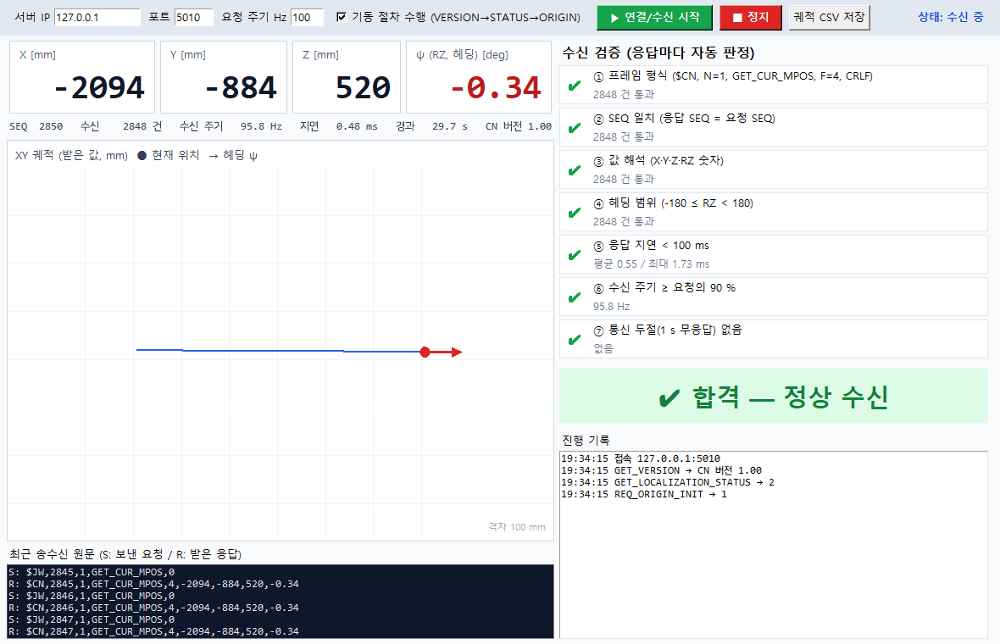

*받는 쪽(JW) 검증기 화면 — Gazebo 로봇이 움직이는 동안 TCP 로 받은 X·Y·Z·ψ 를 표시하고 7개 항목을 자동 판정한다.*

---

## 목차

1. [목적 — 무엇을 하는가](#1-목적--무엇을-하는가)
2. [전체 구성](#2-전체-구성)
3. [저장소 구조](#3-저장소-구조)
4. [설치 — Windows 에서 처음부터](#4-설치--windows-에서-처음부터)
5. [실행 — 터미널 2개면 된다](#5-실행--터미널-2개면-된다)
6. [통신 상세 — 토픽 · 주기 · TCP 프레임](#6-통신-상세--토픽--주기--tcp-프레임)
7. [코드별 입력 · 출력 (수정할 때 보는 표)](#7-코드별-입력--출력-수정할-때-보는-표)
8. [검증 — 잘 됐는지 어떻게 아는가](#8-검증--잘-됐는지-어떻게-아는가)
9. [받는 쪽(JW) 검증기 — ROS 없이](#9-받는-쪽jw-검증기--ros-없이)
10. [실제 장비로 넘어갈 때](#10-실제-장비로-넘어갈-때)
11. [문제 해결](#11-문제-해결)
12. [README ↔ PDF 자동 연동](#12-readme--pdf-자동-연동)
13. [확인이 필요한 것 · 남은 일](#13-확인이-필요한-것--남은-일)

---

# 1. 목적 — 무엇을 하는가

| 항목 | 내용 |
| --- | --- |
| 보내는 값 | 로봇 위치 **X, Y, Z [mm]** + 헤딩 **ψ = RZ [deg]** (4개) |
| 보내는 방식 | 통신 사양서 Rev1.5 의 **`GET_CUR_MPOS`** 응답 — TCP, ASCII, 포트 **5010** |
| 역할 | **CN(충남대) = TCP 서버**, JW(주원 통합제어기) = TCP 클라이언트. JW 가 묻고 CN 이 답한다 |
| 위치 소스 (지금) | Gazebo 시뮬레이션의 로봇 참값 → **ZeroKey 센서 토픽으로 모사** |
| 위치 소스 (나중) | 실제 ZeroKey RTLS — **같은 토픽 이름·타입**이라 코드 수정 없이 교체 |
| 자세 처리 | ZeroKey 쿼터니언 → 헤딩(Yaw) 하나만 뽑는다. Roll·Pitch 는 보내지 않는다 |
| 속도 | `/zerokey/vel` 은 실기와 똑같이 내지만 `GET_CUR_MPOS` 에는 쓰지 않는다 |

ZeroKey 토픽 이름·메시지 타입은 실기 Simulink 모델 `Tracked_UGV_ZeroKey_XsensIMU.slx` 의
ROS 2 Subscribe 블록에서 그대로 가져왔다.

| Simulink Subscribe 블록 | 토픽 | 메시지 타입 | QoS |
| --- | --- | --- | --- |
| Subscribe9 | `/zerokey/position` | `geometry_msgs/PointStamped` | Reliable · Volatile · KeepLast 10 |
| Subscribe12 | `/zerokey/orientation` | `geometry_msgs/QuaternionStamped` | 〃 |
| Subscribe10 | `/zerokey/vel` | `geometry_msgs/TwistStamped` | 〃 |
| Subscribe11 | `/imu/data` | `sensor_msgs/Imu` (Xsens — 이 브리지에서는 안 씀) | 〃 |

---

# 2. 전체 구성

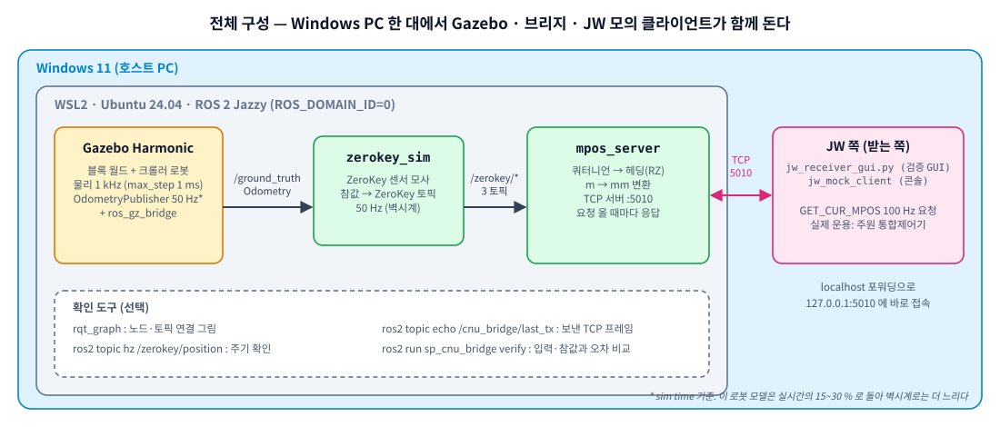

데이터는 왼쪽에서 오른쪽으로 한 방향으로 흐른다.

1. **Gazebo** 가 로봇을 물리 시뮬레이션하고, 로봇의 실제 위치·자세를 `/ground_truth` 로 낸다.
2. **`zerokey_sim`** 이 그것을 받아 **ZeroKey 와 똑같은 토픽 3개**(`/zerokey/position` · `orientation` · `vel`)로 50 Hz 에 다시 낸다.
3. **`mpos_server`** 가 `/zerokey/position` 과 `/zerokey/orientation` 을 구독해 **최신값**을 들고 있다가,
   JW 가 TCP 로 `GET_CUR_MPOS` 를 물을 때마다 **X·Y·Z[mm], ψ[deg]** 로 바꿔 답한다.
4. **JW 쪽** — 지금은 이 저장소의 `jw_mock_client`(콘솔) 또는 `jw_receiver_gui`(검증 GUI)가,
   실제 운용에서는 주원 통합제어기가 100 Hz 로 묻는다.

---

# 3. 저장소 구조

```
smartpainting-cnu-jw-bridge/
├── README.md                     ← 지금 이 문서 (= PDF 매뉴얼의 원본)
├── install.sh                    ← ★ 한 번에 설치 (ROS2 Jazzy + Gazebo + 빌드 + bashrc)
│
├── src/
│   ├── sp_cnu_bridge/            ← ★ 이번에 만든 패키지 (CNU → JW 위치 브리지)
│   │   ├── sp_cnu_bridge/
│   │   │   ├── protocol.py         프레임 해석/생성, 쿼터니언→헤딩, 단위 변환 (ROS 무관)
│   │   │   ├── zerokey_sim.py      Gazebo 참값 → /zerokey/* (ZeroKey 모사)
│   │   │   ├── mpos_server.py      /zerokey/* → TCP 서버 :5010 (GET_CUR_MPOS 응답)
│   │   │   ├── jw_mock_client.py   JW 흉내 콘솔 클라이언트 (ROS 불필요, 파일 하나)
│   │   │   └── verify.py           종단 검증: TCP 값 vs 브리지 입력·Gazebo 참값 → 표 + 그래프
│   │   ├── config/bridge.yaml      ★ 파라미터 (포트, 단위, 소수 자릿수, 토픽 이름)
│   │   ├── launch/bridge.launch.py       브리지 노드 2개만
│   │   ├── launch/bridge_demo.launch.py  Gazebo + 브리지 한 번에
│   │   └── test/test_protocol.py   단위 테스트 15개
│   ├── sp_gazebo/                시뮬레이션 월드·런치·로봇 동작(patrol, maneuver) — 기존
│   ├── sp_description/           로봇 URDF·메시 — 기존
│   └── sp_localization/          IMU+휠 ESKF 위치추정 — 기존
│
├── jw_receiver/                  ← ★ 받는 쪽(주원) 검증기 — ROS 불필요
│   ├── jw_receiver_gui.py          GUI: X·Y·Z·ψ 표시 + 7개 항목 자동 판정
│   └── run_receiver.bat            Windows 더블클릭 실행
│
├── docs/
│   ├── manual/CNU_JW_Bridge_Manual.pdf  ← README 에서 자동 생성되는 PDF
│   ├── img/                       그림 (diagram_*.svg 는 img/src/make_diagrams.py 로 생성)
│   ├── HANDOVER.md                원래 시뮬레이션 인수인계 문서 (로봇·월드·ESKF)
│   └── robot.md · localization.md · world.md · vmware.md
│
├── tools/docs/                   ← README → PDF 변환 도구 (md2pdf.sh, pdf_sync.sh, 템플릿)
├── .github/workflows/pdf.yml     ← push 하면 PDF 자동 재생성
├── .githooks/pre-commit          ← 커밋할 때 PDF 자동 재생성 (선택)
└── cad/                          원본 STEP 도면
```

> [!TIP]
> **처음 보는 사람이 볼 곳**  
> 브리지만 고칠 사람은 `src/sp_cnu_bridge/` 와 `config/bridge.yaml` 만 보면 된다.
> 시뮬레이션(로봇·월드·ESKF)은 [docs/HANDOVER.md](docs/HANDOVER.md) 에 따로 정리돼 있다.

---

# 4. 설치 — Windows 에서 처음부터

**필요한 것:** Windows 10 22H2 이상 또는 Windows 11, 인터넷, 디스크 여유 약 15 GB.
전부 따라 하는 데 **3–0분**(대부분 내려받기 시간)이 걸린다.

## 4-1. WSL2 + Ubuntu 24.04 설치 (Windows, 한 번만)

**시작 메뉴 → "PowerShell" 우클릭 → 관리자 권한으로 실행** 후 한 줄:

```powershell
wsl --install -d Ubuntu-24.04
```

- 끝나면 **재부팅**한다.
- 재부팅 후 Ubuntu 창이 저절로 열리고 **사용자 이름과 암호**를 묻는다. 아무거나 정하되 **암호는 꼭 기억**한다
  (뒤에서 `sudo` 할 때 쓴다. 입력할 때 화면에 아무것도 안 보이는 게 정상이다).
- 이미 다른 Ubuntu 가 깔려 있어도 괜찮다. 24.04 가 따로 하나 더 생긴다.

설치 확인 (PowerShell):

```powershell
wsl -l -v
```

`Ubuntu-24.04   Running   2` 처럼 **VERSION 이 2** 이면 된다.

> [!WARNING]
> **반드시 Ubuntu **24.04****  
> ROS 2 Jazzy 는 24.04 에서만 apt 로 깔린다. 22.04 에서는 `install.sh` 가 1단계에서 멈춘다.

## 4-2. 저장소 받기 (Ubuntu 창)

시작 메뉴에서 **Ubuntu 24.04** 를 열고:

```bash
sudo apt update && sudo apt install -y git
mkdir -p ~/ws && cd ~/ws
git clone https://github.com/wkyouncnu/smartpainting-cnu-jw-bridge.git
cd smartpainting-cnu-jw-bridge
```

> [!WARNING]
> **`~/ws` 에 받는다 (C: 나 D: 드라이브 말고)**  
> `/mnt/c/...`, `/mnt/d/...` 처럼 Windows 드라이브 안에서 빌드하면 매우 느리고 권한 오류가 난다.

## 4-3. 한 번에 설치 — `install.sh`

```bash
bash install.sh
```

암호를 한 번 묻는다(4-1 에서 정한 Ubuntu 암호). 그다음은 손댈 것이 없다.
스크립트가 7단계를 차례로 하고, 단계마다 `[OK]` 를 찍는다.

| 단계 | 하는 일 | 걸리는 시간 |
| --- | --- | --- |
| [1/7] 환경 확인 | Ubuntu 24.04 인지, WSL 인지, 인터넷이 되는지 | 몇 초 |
| [2/7] 로케일 | UTF-8 설정 | 30초 |
| [3/7] ROS2 저장소 | `ros2-apt-source` 패키지로 apt 저장소 등록 | 30초 |
| [4/7] 패키지 설치 | ROS 2 Jazzy desktop + Gazebo Harmonic + ros_gz + rqt 등 (약 – GB) | **1–0분** |
| [5/7] rosdep | 의존성 데이터베이스 | 1분 |
| [6/7] 빌드 | `colcon build --symlink-install` (sp_* 패키지 4개) | 1분 |
| [7/7] bashrc | 새 터미널을 열면 ROS 가 자동으로 잡히게 등록 | 즉시 |

**성공하면 이렇게 끝난다** (실제 실행 화면):

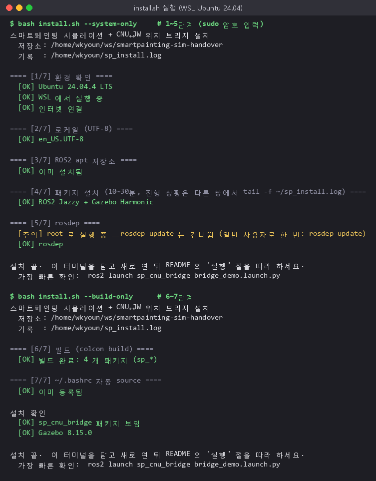

- 중간에 실패하면 **어느 단계에서 왜** 멈췄는지 빨간 글씨로 찍고 기록 마지막 15줄을 보여 준다.
  → [11장 문제 해결](#11-문제-해결) 에서 그 단계 이름을 찾는다. 고친 뒤 `bash install.sh` 를 **다시 실행하면 이어서** 간다.
- 전체 기록은 `~/sp_install.log`. 4단계 진행 상황을 보고 싶으면 다른 Ubuntu 창에서 `tail -f ~/sp_install.log`.

**설치가 끝나면 Ubuntu 창을 닫고 새로 연다** (bashrc 적용).

---

# 5. 실행 — 터미널 2개면 된다

Ubuntu 창을 **2개** 연다 (시작 메뉴 → Ubuntu 24.04 를 두 번, 또는 Windows Terminal 에서 탭 추가).

## 터미널 ① — Gazebo + 브리지 한 번에

```bash
ros2 launch sp_cnu_bridge bridge_demo.launch.py
```

2–0초 뒤 Gazebo 창이 뜨고 블록 안에 로봇이 놓인다.
터미널에 아래 두 줄이 보이면 브리지가 준비된 것이다.

```text
[zerokey_sim]: ZeroKey 모사 시작: /ground_truth → /zerokey/{position,orientation,vel} @ 50 Hz ...
[mpos_server]: TCP 서버 대기 0.0.0.0:5010  (단위 X·Y·Z ×1000, 소수 0자리 / RZ deg 소수 2자리)
```

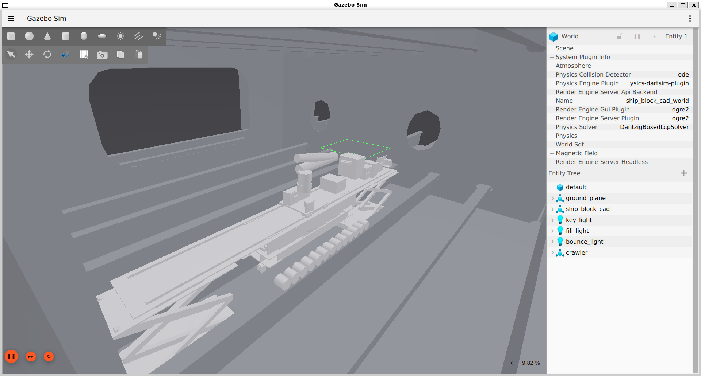

| 옵션 | 언제 |
| --- | --- |
| `gui:=false` | 창 없이. 훨씬 빠르다 (검증만 할 때) |
| `software_render:=true` | Gazebo 화면이 검게 나오거나 깨질 때 |
| `rviz:=true` | RViz 도 같이 |
| `port:=5011` | 포트를 바꿀 때 |

## 터미널 ② — JW 흉내 (받는 쪽)

```bash
ros2 run sp_cnu_bridge jw_mock_client
```

사양서 순서대로 `GET_VERSION → GET_LOCALIZATION_STATUS → REQ_ORIGIN_INIT` 를 하고,
`GET_CUR_MPOS` 를 **100 Hz** 로 물어 0.2 초마다 한 줄씩 찍는다.

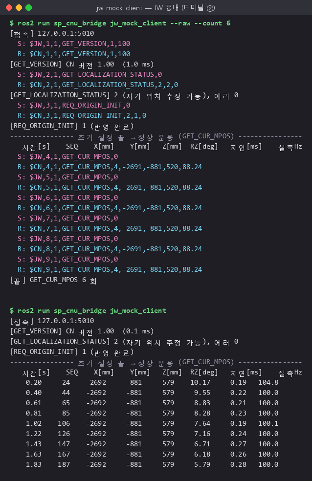

`--raw` 를 붙이면 오가는 프레임 원문이 전부 보인다.

## (선택) 로봇 움직이기 — 터미널 ③

```bash
ros2 run sp_gazebo patrol.py          # ㅁ자 순회: 직진 → 잭업·90° 회전 → 횡이동 → 복귀 (헤딩이 바뀐다)
ros2 run sp_gazebo maneuver.py -d 0.5 # 앞으로 주행 → 덱 회전 → 착지
```

로봇이 움직이면 터미널 ② 의 X·Y·RZ 가 따라 바뀐다.

## 끝낼 때

각 터미널에서 `Ctrl+C` 를 누른 뒤, **반드시** 한 줄 더:

```bash
ros2 run sp_gazebo cleanup.sh
```

`남은 프로세스: 0` 이 나와야 정상이다. 이걸 빼먹으면 다음 실행 때 `포트 5010 을 열 수 없다` 가 난다 ([11장](#11-문제-해결)).

---

# 6. 통신 상세 — 토픽 · 주기 · TCP 프레임

## 6-1. ROS 2 토픽 흐름

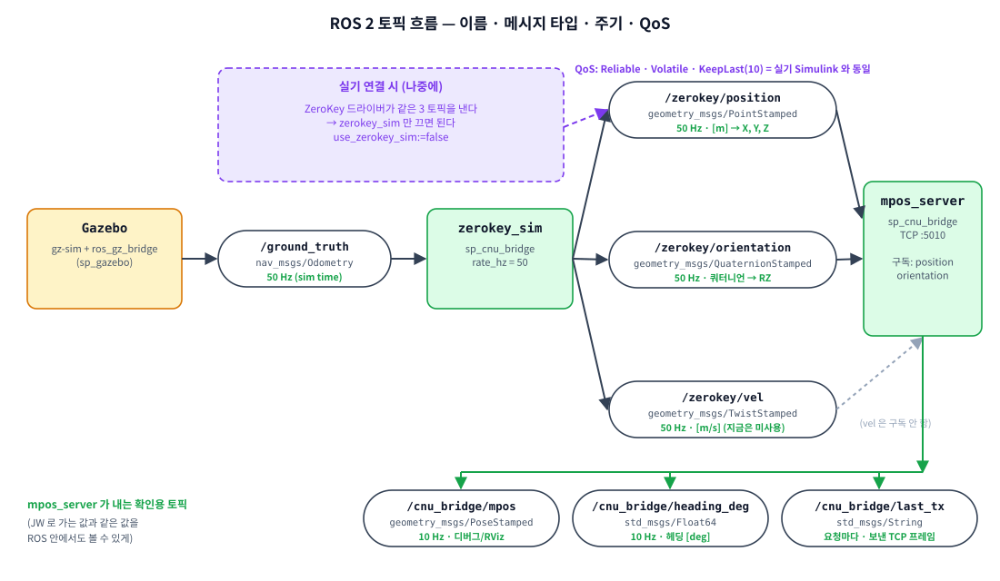

| 토픽 | 메시지 타입 | 내는 노드 → 받는 노드 | 주기 | 단위 · 내용 |
| --- | --- | --- | --- | --- |
| `/ground_truth` | `nav_msgs/Odometry` | Gazebo(ros_gz_bridge) → `zerokey_sim` | 50 Hz (sim time) | 로봇 바퀴부 중심의 참 위치[m]·자세(쿼터니언)·속도 |
| `/zerokey/position` | `geometry_msgs/PointStamped` | `zerokey_sim` → `mpos_server` | **50 Hz** | `point.x/y/z` [m], `frame_id=zerokey` |
| `/zerokey/orientation` | `geometry_msgs/QuaternionStamped` | `zerokey_sim` → `mpos_server` | **50 Hz** | `quaternion.x/y/z/w` |
| `/zerokey/vel` | `geometry_msgs/TwistStamped` | `zerokey_sim` → (없음) | 50 Hz | 월드 좌표 속도 [m/s] — 지금은 미사용 |
| `/cnu_bridge/mpos` | `geometry_msgs/PoseStamped` | `mpos_server` → (RViz 등) | 10 Hz | JW 로 보내는 것과 같은 위치·헤딩 [m] |
| `/cnu_bridge/heading_deg` | `std_msgs/Float64` | `mpos_server` → (rqt_plot 등) | 10 Hz | 헤딩 [deg], [-180, 180) |
| `/cnu_bridge/last_tx` | `std_msgs/String` | `mpos_server` → (echo) | 요청마다 | 마지막으로 보낸 TCP 프레임 원문 |

QoS 는 `/zerokey/*` 전부 **Reliable · Volatile · KeepLast(10)** — 실기 Simulink 와 같다.

> [!NOTE]
> **주기에 대해**  
> - Gazebo 는 **sim time** 기준 50 Hz 로 `/ground_truth` 를 낸다. 이 로봇 모델은 무거워서 실시간의
>   1–0 % 로 돌기 때문에, 벽시계로 재면 `/ground_truth` 는 그보다 느리다.
> - `zerokey_sim` 은 **벽시계 50 Hz** 로 내므로 `ros2 topic hz /zerokey/position` 은 늘 50 Hz 다
>   (새 참값이 안 왔으면 마지막 값을 다시 낸다 — 실제 센서처럼 일정한 주기를 보장).
> - TCP 는 JW 가 묻는 주기를 따른다. 사양서 정상 운용 주기는 **100 Hz**.

실제 실행 중인 시스템에서 뽑은 **rqt_graph** (브리지 부분만):

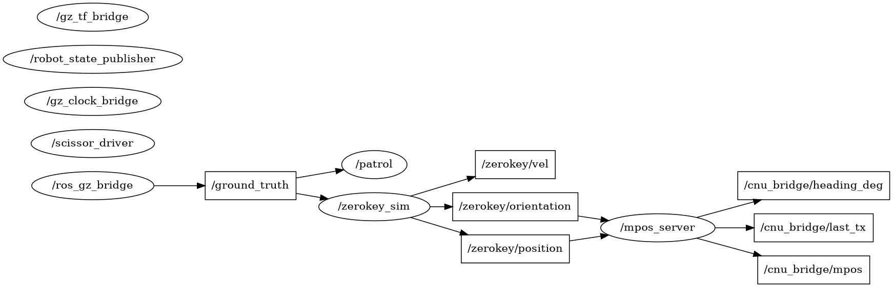

`/ros_gz_bridge → /ground_truth → /zerokey_sim → /zerokey/* → /mpos_server → /cnu_bridge/*` 가 그대로 보인다.
(`/patrol` 은 로봇 동작 스크립트로, 참값을 보고 동작 완료를 판정한다.)

<details>
<summary>전체 rqt_graph (Gazebo 관절 토픽 포함)</summary>

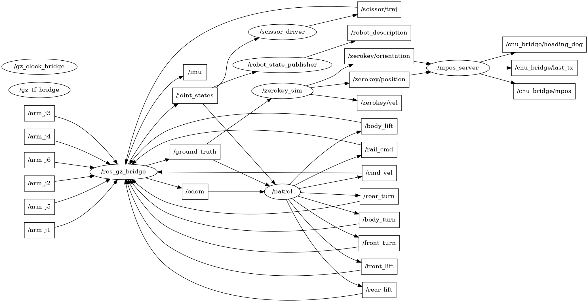

</details>

토픽 주기와 내용 직접 확인 (실제 출력):

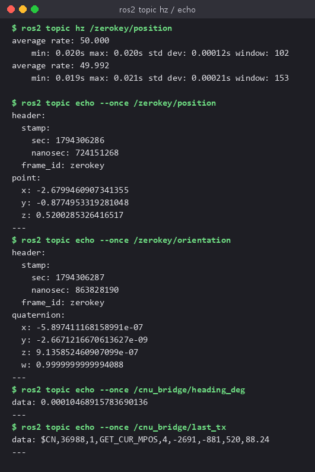

## 6-2. TCP 시퀀스

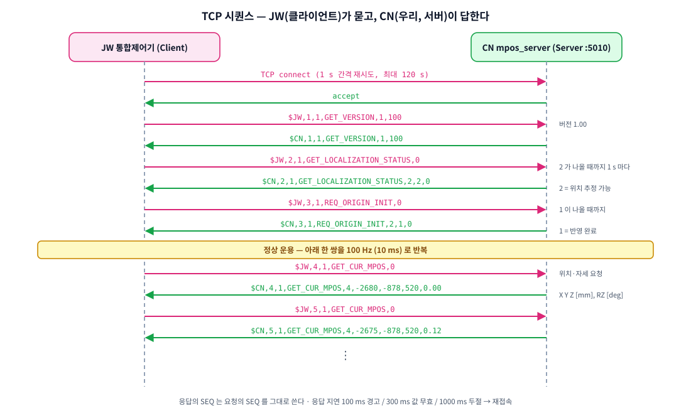

## 6-3. GET_CUR_MPOS 프레임

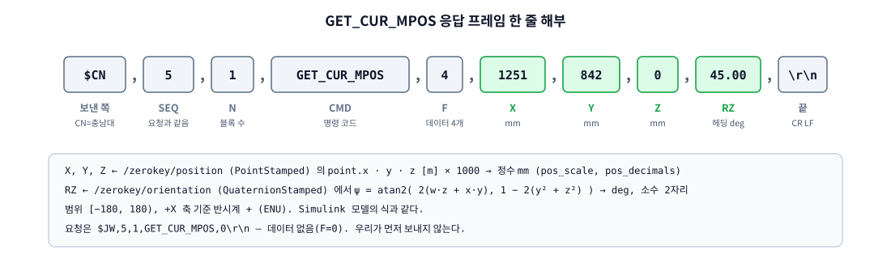

| 구분 | 형식 | 예 |
| --- | --- | --- |
| 요청 (JW→CN) | `$JW,<SEQ>,1,GET_CUR_MPOS,0\r\n` | `$JW,5,1,GET_CUR_MPOS,0` |
| 응답 (CN→JW) | `$CN,<SEQ>,1,GET_CUR_MPOS,4,<X>,<Y>,<Z>,<RZ>\r\n` | `$CN,5,1,GET_CUR_MPOS,4,-2680,-877,520,0.00` |

| 필드 | 출처 | 변환 | 기본 형식 |
| --- | --- | --- | --- |
| X, Y, Z | `/zerokey/position` 의 `point.x·y·z` [m] | × 1000 → 반올림 | **mm 정수** |
| RZ (ψ) | `/zerokey/orientation` 쿼터니언 | ψ = atan2(2(wz+xy), 1−2(y²+z²)) → deg | **deg, 소수 2자리, [−180, 180)** |

- 헤딩은 **+X 축 기준 반시계가 +** (ROS ENU 관례). Simulink 모델의 식과 같다.
- 응답 SEQ 는 **요청 SEQ 를 그대로** 쓴다.

## 6-4. 서버가 답하는 명령 전체

이 저장소의 목적은 `GET_CUR_MPOS` 다. 다만 사양서 기동 절차(2-5)상 JW 가 앞의 세 명령을 거쳐야
`GET_CUR_MPOS` 로 넘어오므로, 나머지는 **최소 응답**만 한다.

| 명령 | 요청 데이터 | 응답 데이터 | 이 구현의 동작 |
| --- | --- | --- | --- |
| `GET_VERSION` | 1 (`100`) | 1 (`100`) | 프로토콜 1.00 |
| `GET_LOCALIZATION_STATUS` | 0 | 2 (`상태, 0`) | 상태 0 = 값이 한 번도 안 옴 / 1 = 300 ms 넘게 새 값 없음 / **2 = 정상** |
| `REQ_ORIGIN_INIT` | 0 | 2 (`1, 0`) | 항상 "반영 완료" (원점 오프셋 계산은 미구현) |
| **`GET_CUR_MPOS`** | 0 | **4 (`X, Y, Z, RZ`)** | **핵심** |
| `GET_CUR_MDELTA` | 0 | 4 (`dX, dY, dZ, dRZ`) | 직전 `GET_CUR_MDELTA` 이후 변화량 |
| `SET_ORG_POS_OFFS` · `SET_CUR_APOS` · `SET_CUR_AVEL` · `SET_ROLLER_ENC` | 6/6/6/4 | 0 | 수신 확인만 (값은 쓰지 않음) |
| 그 밖의 명령 | F 개 | — | F 개수만큼 건너뛰고 응답 안 함 (로그만) |

한 프레임에 블록이 여러 개(N>1) 들어와도 블록마다 처리해 한 줄로 답한다.

---

# 7. 코드별 입력 · 출력 (수정할 때 보는 표)

## 7-1. 한눈에

| 프로그램 | 실행 | 입력 | 출력 | ROS 필요 |
| --- | --- | --- | --- | --- |
| `zerokey_sim` | `ros2 run sp_cnu_bridge zerokey_sim` | `/ground_truth` | `/zerokey/position` · `orientation` · `vel` | O |
| `mpos_server` | `ros2 run sp_cnu_bridge mpos_server` | `/zerokey/position` · `orientation`, **TCP 요청** | **TCP 응답**, `/cnu_bridge/*` | O |
| `jw_mock_client` | `ros2 run sp_cnu_bridge jw_mock_client` | TCP 응답 | 화면 표, CSV(선택) | X (파일 하나) |
| `verify` | `ros2 run sp_cnu_bridge verify` | `/zerokey/position`·`/zerokey/orientation`, `/ground_truth`, TCP 응답 | 오차 표, PNG 그래프, 종료코드 | O |
| `jw_receiver_gui` | `run_receiver.bat` / `python jw_receiver_gui.py` | TCP 응답 | GUI 화면, 판정, CSV(선택) | X (표준 라이브러리) |

## 7-2. `zerokey_sim` — ZeroKey 모사

파일: `src/sp_cnu_bridge/sp_cnu_bridge/zerokey_sim.py`

| 구분 | 이름 | 타입 / 기본값 | 설명 |
| --- | --- | --- | --- |
| 입력 | `source_topic` 의 토픽 | `nav_msgs/Odometry` | 기본 `/ground_truth`. ESKF 결과를 보내려면 `/odom_eskf` |
| 출력 | `/zerokey/position` | `PointStamped` | 위치 [m] (+ 잡음 선택) |
| 출력 | `/zerokey/orientation` | `QuaternionStamped` | 자세 (+ 헤딩 잡음 선택) |
| 출력 | `/zerokey/vel` | `TwistStamped` | Odometry 의 몸체 속도를 **월드 좌표로 돌려서** 낸다 |
| 파라미터 | `rate_hz` | `50.0` | 발행 주기 |
| 파라미터 | `frame_id` | `zerokey` | header.frame_id |
| 파라미터 | `pos_noise_std` | `0.0` [m] | 위치 가우시안 잡음 (ZeroKey 흉내 0.0–.03) |
| 파라미터 | `yaw_noise_std_deg` | `0.0` [deg] | 헤딩 잡음 |

## 7-3. `mpos_server` — TCP 위치 서버 (핵심)

파일: `src/sp_cnu_bridge/sp_cnu_bridge/mpos_server.py` (프레임 처리는 `protocol.py`)

| 구분 | 이름 | 타입 / 기본값 | 설명 |
| --- | --- | --- | --- |
| 입력 | `/zerokey/position` | `PointStamped` | 최신 위치를 들고 있는다 |
| 입력 | `/zerokey/orientation` | `QuaternionStamped` | 받는 즉시 헤딩[rad]으로 바꿔 둔다 |
| 입력 | TCP `:5010` | ASCII 한 줄 | `$JW,...\r\n` (여러 클라이언트 동시 접속 가능) |
| 출력 | TCP 응답 | ASCII 한 줄 | `$CN,<요청 SEQ>,...\r\n` |
| 출력 | `/cnu_bridge/mpos` | `PoseStamped` 10 Hz | 확인용 |
| 출력 | `/cnu_bridge/heading_deg` | `Float64` 10 Hz | 확인용 |
| 출력 | `/cnu_bridge/last_tx` | `String` | 보낸 프레임 원문 |
| 파라미터 | `host` / `port` | `0.0.0.0` / `5010` | 대기 주소 |
| 파라미터 | `position_topic` / `orientation_topic` | `/zerokey/position` / `/zerokey/orientation` | 입력 토픽 이름 |
| 파라미터 | `pos_scale` | `1000.0` | m → mm. **m 로 보내려면 1.0** |
| 파라미터 | `pos_decimals` | `0` | X·Y·Z 소수 자릿수 (0 = 정수) |
| 파라미터 | `yaw_decimals` | `2` | RZ 소수 자릿수 |
| 파라미터 | `stale_timeout_s` | `0.3` | 이보다 오래 새 값이 없으면 STATUS 를 1 로 |
| 파라미터 | `log_every_n` | `100` | GET_CUR_MPOS 몇 번마다 로그 한 줄 (100 Hz → 1 초) |

## 7-4. `protocol.py` — 순수 함수 (ROS 무관, 테스트 대상)

| 함수 | 입력 → 출력 | 용도 |
| --- | --- | --- |
| `parse_frame(line)` | `"$JW,5,1,GET_CUR_MPOS,0"` → `Frame(src, seq, [Block])` | 모르는 명령도 F 로 건너뛴다. 형식 오류면 `FrameError` |
| `build_frame(src, seq, blocks)` | → `"$CN,5,1,GET_CUR_MPOS,4,...\r\n"` | 응답 문자열 |
| `quat_to_yaw(x, y, z, w)` | → ψ [rad] | atan2(2(wz+xy), 1−2(y²+z²)) |
| `mpos_fields(x, y, z, yaw, ...)` | [m], [rad] → `["1251","842","0","45.00"]` | 단위·자릿수·범위 처리 |
| `split_lines(buf)` | 수신 바이트 → (완결된 줄들, 남은 바이트) | TCP 조각난 수신 처리 |

## 7-5. 무엇을 바꾸려면 어디를 고치나

| 바꾸고 싶은 것 | 고칠 곳 | 다시 빌드? |
| --- | --- | --- |
| 포트, 단위(mm↔m), 소수 자릿수 | `src/sp_cnu_bridge/config/bridge.yaml` | 아니오 (`--symlink-install`) — 노드만 재시작 |
| ZeroKey 토픽 이름 | `bridge.yaml` 의 `position_topic` / `orientation_topic` | 아니오 |
| 시뮬 위치 소스(참값 ↔ ESKF) | 실행 시 `source_topic:=/odom_eskf` 또는 `bridge.yaml` | 아니오 |
| 헤딩 정의(예: 북쪽 기준·시계방향) | `protocol.py` 의 `mpos_fields()` 에서 `wrap_deg(...)` 앞에 변환 추가 + 테스트 수정 | 아니오 |
| 새 명령 추가 (예: 실제 원점 오프셋) | `mpos_server.py` 의 `handle_block()` 에 `if c == "...":` 추가 | 아니오 |
| 응답 형식 자체 | `protocol.py` → `python3 -m pytest src/sp_cnu_bridge/test` 로 확인 | 아니오 |
| 새 실행 파일 추가 | `setup.py` 의 `console_scripts` | **예** (`colcon build`) |

---

# 8. 검증 — 잘 됐는지 어떻게 아는가

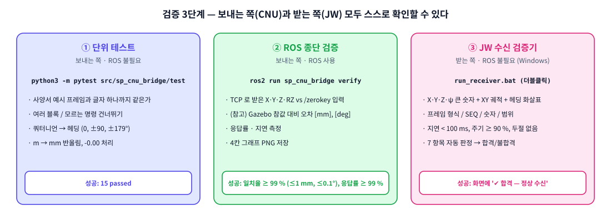

## 8-1. ① 단위 테스트 — 프레임이 사양서와 글자 하나까지 같은가

```bash
cd ~/ws/smartpainting-cnu-jw-bridge
python3 -m pytest src/sp_cnu_bridge/test -v
```

사양서 2-4-5 의 예시 `$CN,5,1,GET_CUR_MPOS,4,1251,842,0,45` 를 그대로 만들어 내는지,
여러 블록·잘린 프레임·쿼터니언 변환·반올림을 확인한다. **성공: `15 passed`**

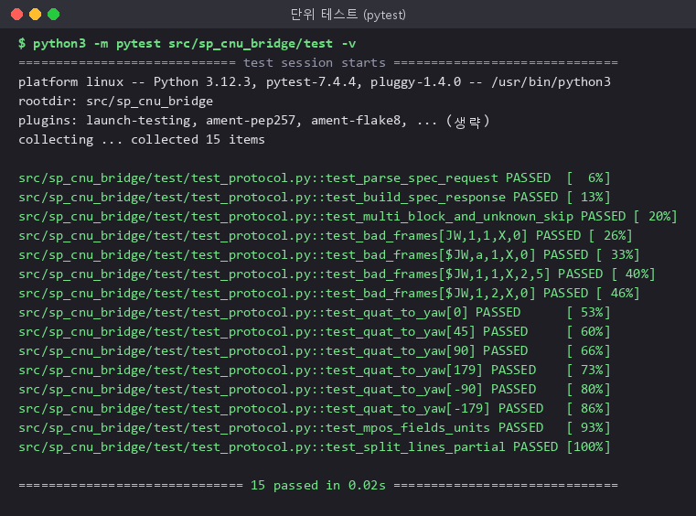

## 8-2. ② ROS 종단 검증 — TCP 로 나간 값이 맞는가

Gazebo + 브리지가 떠 있는 상태에서 (로봇을 움직이면 더 의미 있다):

```bash
ros2 run sp_gazebo patrol.py &                                  # 로봇 움직이기 (ㅁ자 한 바퀴 ≈ 6~7 분)
ros2 run sp_cnu_bridge verify --ros-args -p duration:=60.0      # 60 초 측정
```

`verify` 는 JW 처럼 TCP 로 `GET_CUR_MPOS` 를 100 Hz 로 묻는다. 동시에 **브리지 입력**
(`/zerokey/position`, `/zerokey/orientation`)과 **Gazebo 참값**(`/ground_truth`)을 받은 시각과 함께
모두 기록해 두고, 끝나면 오차를 두 가지로 계산한다.

| 오차 | TCP 응답을 무엇과 비교 | 무엇을 보나 | 판정 |
| --- | --- | --- | --- |
| ① 브리지 정확성 | 응답 직전 **100 ms 동안 유효했던 `/zerokey` 입력** 중 가장 가까운 것 | `mpos_server` 가 변환(m→mm, 쿼터니언→ψ)·전송하면서 값을 틀리게 만들지 않았나 | **합격 판정** |
| ② 참값 대비 | 응답 **그 순간의 최신 `/ground_truth`** | 센서(`zerokey_sim`)까지 포함해 값이 얼마나 최신인가 | 참고 |

| 판정 항목 | 합격 기준 | 근거 |
| --- | --- | --- |
| 일치율 | **≥ 99 %** | ① 오차가 위치 ≤ 1 mm (mm 반올림 ±0.5) · 헤딩 ≤ 0.1° (소수 2자리 반올림) 인 응답의 비율 |
| 응답률 | **≥ 99 %** | 보낸 요청 대비 정상 응답 |
| 응답 지연 최대 | **< 100 ms** | 사양서 응답 시한 |

기준값은 파라미터로 바꿀 수 있다: `pos_tol_mm`, `yaw_tol_deg`, `match_window_ms`.

실제 결과 (patrol 로 직진 1.2 m · 횡이동 0.845 m · 90° 회전 두 번, 430 초 / 43 000 응답):

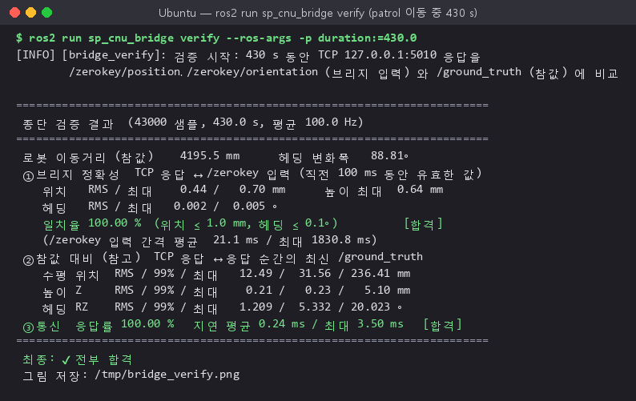

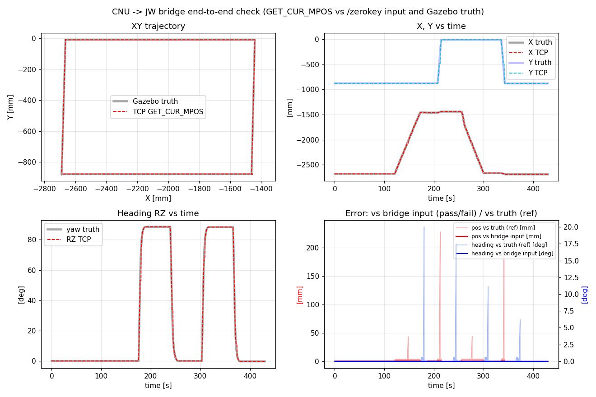

*왼쪽 위: XY 궤적(회색 굵은 선 = 참값, 빨간 점선 = TCP 로 받은 값) · 오른쪽 위: X·Y 시간 변화 ·
왼쪽 아래: 헤딩 ψ · 오른쪽 아래: 오차 (진한 선 = ① 브리지 입력 대비, 연한 선 = ② 참값 대비).*

결과 읽기

| 항목 | 값 | 뜻 |
| --- | --- | --- |
| ① 일치율 | **100.00 %** (최대 0.70 mm, 0.005°) | 브리지는 받은 값을 반올림 말고는 **한 번도 바꾸지 않았다** |
| ③ 통신 | 응답률 100 %, 지연 평균 0.24 ms / 최대 3.5 ms | 100 Hz 요청을 전부, 시한(100 ms)보다 훨씬 빨리 답했다 |
| ② 참값 대비 | RMS 12 mm · 1.2°, 최대 236 mm · 20° (봉우리) | 정지·저속 구간은 반올림 수준. 봉우리는 아래 참고 |

> [!WARNING]
> **② 참값 대비 오차에 봉우리가 생기는 이유 — 브리지가 아니라 시뮬레이션 환경 탓**  
> · `zerokey_sim` 은 참값을 50 Hz 로 다시 내보내므로 값이 최대 약 20 ms 늦다. 그 사이 움직인 만큼 오차로 보인다.  
> · 그런데 위 실행에서는 `/zerokey` 입력 간격이 **최대 1.8 초**까지 벌어진 때가 있었다(표의 `입력 간격 최대`).
> WSL 에서 Gazebo(소프트웨어 렌더)·물리·patrol 이 CPU 를 다 쓰면 Python 노드가 잠시 멈추기 때문이다.
> `/ground_truth` 자체도 최대 0.3 초 간격으로 들어왔다 (Gazebo 실시간 비율 1–0 %).  
> · 그 순간 로봇이 잭업·회전 중이면 봉우리가 커진다. **봉우리 위치는 실행할 때마다 달라진다.**  
> · 실제 ZeroKey 를 붙이면 이 단계는 장비의 갱신 주기로 바뀐다. 실장비에서는 ① 만 판정에 쓰면 된다.
> 봉우리를 줄이려면 Gazebo 창을 끄고(`gui:=false`) 다른 프로그램을 닫는다.

## 8-3. 서버 로그로 보기

`mpos_server` 는 접속·기동 명령·GET_CUR_MPOS(1 초에 한 줄)를 `RX ... → TX ...` 로 남긴다.

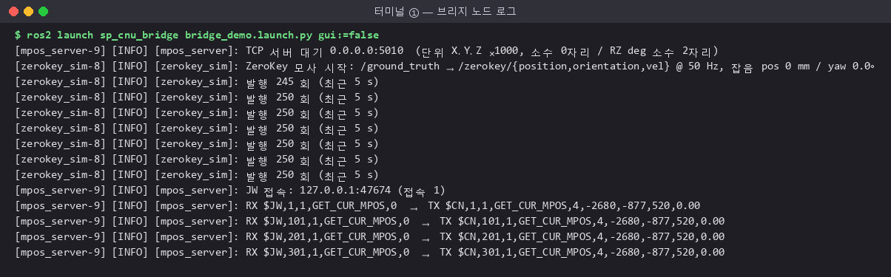

## 8-4. 성공했을 때 보이는 것 — 체크리스트

| # | 어디서 | 무엇이 보이면 성공 |
| --- | --- | --- |
| 1 | `install.sh` | 마지막에 `설치 끝.` · `[OK] sp_cnu_bridge 패키지 보임` |
| 2 | 터미널 ① | `ZeroKey 모사 시작` · `TCP 서버 대기 0.0.0.0:5010`, `발행 250 회 (최근 5 s)` 가 5 초마다 |
| 3 | `ros2 topic hz /zerokey/position` | `average rate: 50.0` |
| 4 | `jw_mock_client` | `GET_LOCALIZATION_STATUS 2`, `REQ_ORIGIN_INIT 1`, 표의 `실측Hz` ≈ 100, 지연 < 1 ms |
| 5 | Gazebo 로봇 정지 시 | X ≈ −2680, Y ≈ −877, Z ≈ 520 mm, RZ ≈ 0.00 (스폰 위치) |
| 6 | `verify` | `최종: ✔ 전부 합격` |
| 7 | JW 수신 검증기 | `✔ 합격 — 정상 수신`, 7 항목 모두 ✔ |

---

# 9. 받는 쪽(JW) 검증기 — ROS 없이

주원테크놀러지 쪽에서 **ROS 도 Ubuntu 도 없이** "CNU 가 보낸 X·Y·Z·ψ 가 제대로 오는가" 를 보는 프로그램이다.
파일은 `jw_receiver/` 폴더 하나 — 이 폴더만 복사해 가면 된다.

## 9-1. 실행

**Windows:** Python 3.8 이상만 있으면 된다 (추가 설치 없음 — tkinter·socket 은 Python 에 기본 포함).

1. `jw_receiver/run_receiver.bat` 를 **더블클릭**
2. 서버 IP·포트 확인 (같은 PC 의 WSL 에서 서버를 돌리면 `127.0.0.1`, `5010`)
3. **▶ 연결/수신 시작**

```bash
# 명령줄로
python jw_receiver_gui.py --host 192.168.0.10 --port 5010
python jw_receiver_gui.py --nogui --duration 20          # 창 없이, 20 초 측정 후 판정
python jw_receiver_gui.py --csv rx_log.csv               # 받은 값 전부 CSV 로
python jw_receiver_gui.py --no-handshake                 # 기동 절차 생략, 바로 GET_CUR_MPOS
```

## 9-2. 화면 읽기


| 영역 | 내용 |
| --- | --- |
| 위 숫자 4개 | 마지막으로 받은 **X, Y, Z [mm], ψ [deg]** — 받은 문자열을 그대로 보여 준다 |
| 그 아래 줄 | SEQ · 수신 건수 · 실측 수신 주기 · 응답 지연 · 경과 시간 · CN 버전 |
| 가운데 | 받은 값으로 그린 **XY 궤적** + 현재 위치(빨간 점) + **헤딩 화살표** |
| 아래 검은 칸 | 최근 송수신 원문 (`S:` 보낸 요청 / `R:` 받은 응답) |
| 오른쪽 | **7개 항목 자동 판정** 과 종합 결과 |

| # | 판정 항목 | 무엇을 보는가 |
| --- | --- | --- |
| ① | 프레임 형식 | `$CN` 시작, N=1, CMD=`GET_CUR_MPOS`, F=4, `\r\n` 로 끝남, 필드 9개 |
| ② | SEQ 일치 | 응답 SEQ = 방금 보낸 요청 SEQ |
| ③ | 값 해석 | X·Y·Z·RZ 가 모두 숫자 |
| ④ | 헤딩 범위 | −180 ≤ RZ < 180 |
| ⑤ | 응답 지연 | 모든 응답이 100 ms 안에 (사양서 2-7) |
| ⑥ | 수신 주기 | 실측 수신 주기 ≥ 요청 주기의 90 % |
| ⑦ | 통신 두절 | 1 초 이상 무응답이 한 번도 없음 |

50 건 이상 받으면 판정을 시작한다. **한 번이라도 실패하면 그 항목은 ✘ 로 남고** 실패 이유(마지막 실패 값)를 보여 준다.

창 없이(`--nogui`) 돌린 결과 — Windows PowerShell 에서 WSL 서버로 접속:

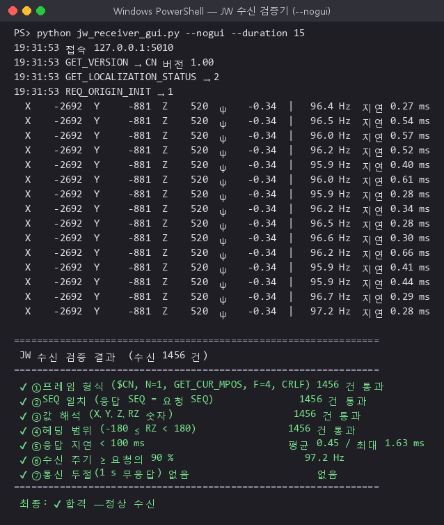

> [!NOTE]
> **Windows 에서 주기가 95 Hz 근처로 나오는 이유**  
> Windows 의 `time.sleep` 해상도 때문이다 (서버 문제가 아니다). 판정 기준(90 %)은 이를 감안했다.
> 실제 통합제어기는 자체 주기로 묻기 때문에 상관없다.

---

# 10. 실제 장비로 넘어갈 때

## 10-1. 실제 ZeroKey 를 붙일 때

ZeroKey 드라이버가 `/zerokey/position`, `/zerokey/orientation` 을 같은 타입으로 내면, **모사 노드만 끈다**:

```bash
ros2 launch sp_cnu_bridge bridge.launch.py use_zerokey_sim:=false
```

확인할 것: `ros2 topic hz /zerokey/position` 주기, `ros2 topic echo --once /zerokey/position` 의 단위가 **m** 인지,
ZeroKey 좌표계의 +X 와 블록 좌표의 +X 가 같은지 (헤딩 0° 방향).

## 10-2. 주원 통합제어기(다른 PC)가 접속할 때

WSL2 는 기본적으로 NAT 뒤에 있어서, **같은 PC** 에서는 `127.0.0.1:5010` 으로 바로 되지만
**다른 PC** 에서는 Windows 의 IP 로 들어온 접속을 WSL 로 넘겨 줘야 한다. 둘 중 하나:

**방법 A — 미러 네트워킹 (Windows 11 22H2 이상, 권장)**
`C:\Users\<사용자>\.wslconfig` 파일을 만들고:

```ini
[wsl2]
networkingMode=mirrored
```

PowerShell 에서 `wsl --shutdown` 후 Ubuntu 를 다시 열면 WSL 이 Windows 와 같은 IP 를 쓴다.

**방법 B — 포트 포워딩** (관리자 PowerShell, WSL 을 재시작할 때마다 IP 가 바뀌면 다시)

```powershell
$wsl = (wsl -d Ubuntu-24.04 hostname -I).Trim().Split(" ")[0]
netsh interface portproxy add v4tov4 listenport=5010 listenaddress=0.0.0.0 connectport=5010 connectaddress=$wsl
```

**두 방법 모두 방화벽을 연다** (관리자 PowerShell, 한 번만):

```powershell
New-NetFirewallRule -DisplayName "CNU MPOS 5010" -Direction Inbound -Protocol TCP -LocalPort 5010 -Action Allow
```

그다음 JW PC 에서 `python jw_receiver_gui.py --host <Windows PC 의 IP>` 로 먼저 확인한다.

---

# 11. 문제 해결

## 11-1. 설치 (`install.sh`) — 멈춘 단계 이름으로 찾는다

| 멈춘 단계 / 메시지 | 원인 | 해결 |
| --- | --- | --- |
| `[1/7] Ubuntu 24.04 (noble) 이 아닙니다` | 22.04 등 다른 버전 Ubuntu 에서 실행 | PowerShell: `wsl --install -d Ubuntu-24.04` → 그 창에서 다시 |
| `[1/7] packages.ros.org 에 접속할 수 없습니다` | 인터넷·프록시·DNS | `ping -c 3 8.8.8.8` 확인. 학교/회사 프록시면 `export https_proxy=...` 후 재실행. DNS 문제면 `echo "nameserver 8.8.8.8" \| sudo tee /etc/resolv.conf` |
| `sudo: 3 incorrect password attempts` | Ubuntu 암호 틀림 | PowerShell: `wsl -d Ubuntu-24.04 -u root passwd <사용자이름>` 으로 암호 재설정 |
| `[3/7] GitHub API 응답 없음` | GitHub API 호출 제한·일시 장애 | –분 뒤 `bash install.sh` 재실행 |
| `[4/7]` `Could not get lock /var/lib/dpkg/lock` | 다른 apt 가 돌고 있음 (자동 업데이트) | 몇 분 기다렸다가 재실행. 계속되면 `sudo killall apt apt-get` |
| `[4/7]` `Unable to locate package ros-jazzy-...` | 3단계 저장소 등록 실패 | `sudo apt update` 출력에 `packages.ros.org` 가 있는지 확인 → 없으면 `sudo dpkg -r ros2-apt-source` 후 재실행 |
| `[4/7]` `Hash Sum mismatch` / 내려받기 끊김 | 네트워크 불안정 | 그냥 재실행 (이어서 받는다) |
| `[4/7]` `No space left on device` | 디스크 부족 | Windows C: 여유 15 GB 이상 확보 |
| `[6/7] /opt/ros/jazzy 없음` | 4단계가 안 끝남 | `bash install.sh` 처음부터 |
| `[6/7]` 빌드 실패 | `~/sp_install.log` 에서 `Failed` 위 줄 확인 | 보통 `rm -rf build install log` 후 `bash install.sh --build-only` |
| `[주의] 저장소가 Windows 드라이브에 있습니다` | `/mnt/c`, `/mnt/d` 에 clone 함 | `~/ws` 에 다시 clone ([4-2](#4-2-저장소-받기-ubuntu-창)) |

## 11-2. 실행할 때

| 증상 | 원인 | 해결 |
| --- | --- | --- |
| `Package 'sp_cnu_bridge' not found` | 새 터미널인데 bashrc 가 안 먹음 / 빌드 전 | `source ~/ws/smartpainting-cnu-jw-bridge/install/setup.bash` (또는 터미널을 새로 열기) |
| `포트 5010 를 열 수 없다 ([Errno 98] Address already in use)` | **전에 띄운 `mpos_server` 가 아직 살아 있다** (실제로 겪음) | `ros2 run sp_gazebo cleanup.sh` → `남은 프로세스: 0` 확인. 그래도면 `ss -ltnp \| grep 5010` 으로 PID 확인 후 `kill -9 <PID>` |
| `ros2 node list` / rqt_graph 에 노드가 일부만 보임 | `cleanup.sh` 가 ROS 데몬을 멈춘 뒤 목록이 갱신 안 됨 (실제로 겪음) | `ros2 daemon stop; ros2 daemon start` 후 몇 초 기다렸다 다시 |
| Gazebo 창이 검거나 깨짐 | WSLg GPU 가속 문제 | `bridge_demo.launch.py software_render:=true` |
| Gazebo 가 매우 느림 (실시간 1–0 %) | 이 로봇 모델은 바퀴가 촘촘해 원래 무겁다 | 정상. 검증만 할 때는 `gui:=false` 가 빠르다 |
| `zerokey_sim` 이 `/ground_truth 가 안 들어온다` 경고 | Gazebo 가 아직 안 떴거나 로봇 스폰 실패 | Gazebo 가 완전히 뜰 때까지 30 초 기다림. 계속되면 `ros2 topic list \| grep ground_truth` |
| `jw_mock_client` 가 `[재시도] 접속 대기 중` 만 반복 | 서버가 안 떴거나 포트 다름 | 터미널 ① 에 `TCP 서버 대기 0.0.0.0:5010` 이 있는지 확인 |
| `GET_LOCALIZATION_STATUS 0` 에서 안 넘어감 | `/zerokey/*` 가 안 들어옴 | `ros2 topic hz /zerokey/position` — 안 나오면 `zerokey_sim` 확인 |
| `GET_LOCALIZATION_STATUS 1` 반복 | 새 값이 300 ms 넘게 안 옴 (실기 ZeroKey 끊김 등) | 센서/드라이버 확인. 일부러 늦게 오는 센서면 `stale_timeout_s` 를 늘림 |
| X·Y 가 전부 0 | 위치를 한 번도 못 받은 채로 질의 | 위와 같음 — 이때 STATUS 는 0 이다 |
| Windows 에서 `127.0.0.1:5010` 접속 거부 | WSL localhost 포워딩이 꺼짐 | `wsl --shutdown` 후 재시작. 그래도면 `.wslconfig` 에 `localhostForwarding=true` |
| 다른 PC 에서 접속 안 됨 | WSL NAT · 방화벽 | [10-2](#10-2-주원-통합제어기다른-pc가-접속할-때) |
| 한글이 깨져 보임 (Windows 콘솔) | 콘솔 코드페이지 | `chcp 65001` 또는 Windows Terminal 사용 |
| `run_receiver.bat` 가 바로 꺼짐 | Python 미설치 | python.org 에서 Python 3.8+ 설치 (설치 시 "Add to PATH" 체크) |

## 11-3. 그래도 안 되면

다음을 모아서 보낸다: `~/sp_install.log`, 터미널 ① 출력 전체, `ros2 topic list`, `ss -ltnp | grep 5010`.

---

# 12. README ↔ PDF 자동 연동

**원본은 `README.md` 하나다.** PDF(`docs/manual/CNU_JW_Bridge_Manual.pdf`)는 언제나 여기서 만들어진다.

```text
 README.md 또는 docs/img/* 수정
        │
        ├─ GitHub 에 push (웹에서 직접 고쳐도 마찬가지) ──▶ .github/workflows/pdf.yml
        │                                                   Ubuntu + Chrome + 한글 글꼴로 PDF 생성
        │                                                   → 바뀌었으면 봇이 PDF 커밋
        ├─ 로컬에서 git commit ──▶ .githooks/pre-commit  (Chrome 이 있으면 PDF 를 같은 커밋에 넣음)
        └─ 손으로 ──▶ bash tools/docs/pdf_sync.sh        (README 가 PDF 보다 새로우면 다시 만듦)
```

| 도구 | 하는 일 |
| --- | --- |
| `tools/docs/md2pdf.sh` | MD → HTML(marked.js, 오프라인) → Chrome 헤드리스로 A4 PDF. Windows Git Bash · Ubuntu · GitHub Actions 모두 동작 |
| `tools/docs/pdf_sync.sh` | MD · MD 가 싣는 그림 · 조판 도구 중 하나라도 PDF 보다 새로우면 다시 생성. `--check` 는 검사만 |
| `tools/docs/pdf_targets.txt` | 어떤 MD 를 어떤 PDF 로 — 한 줄에 하나. 문서를 늘리려면 여기 추가 |
| `tools/docs/pdf-template.html` | PDF 모양 (글꼴, 표, 코드 블록, 쪽 번호) |
| `docs/img/src/make_diagrams.py` | 이 문서의 다이어그램(SVG) 생성기. 토픽 이름·주기를 바꾸면 여기 고치고 다시 실행 |

로컬 커밋 훅 켜기 (clone 후 한 번):

```bash
git config core.hooksPath .githooks
```

> [!TIP]
> **그림도 README 와 PDF 가 같은 파일을 쓴다**  
> 다이어그램은 SVG, 캡처는 PNG 로 `docs/img/` 에 있고 README 가 상대경로로 싣는다.
> GitHub 화면과 PDF 에 똑같이 나온다.

---

# 13. 확인이 필요한 것 · 남은 일

| 항목 | 지금 값 | 확인 상대 |
| --- | --- | --- |
| X·Y·Z 단위·자릿수 | mm 정수 (사양서 예시 `1251,842,0` 기준) | 주원 — 소수가 필요하면 `pos_decimals` 만 바꾸면 된다 |
| RZ 단위·범위·방향 | deg 소수 2자리, [−180, 180), +X 기준 반시계 | 주원 — [0, 360) 이나 시계방향이면 `protocol.py` 한 줄 |
| 좌표 원점·축 | Gazebo 월드 원점 (= 블록 도면 좌표) | 주원·RIMS — `SET_ORG_POS_OFFS` / `REQ_ORIGIN_INIT` 실제 구현 여부 |
| `GET_CUR_MDELTA` 의 기준 | 직전 MDELTA 요청 이후 변화량 | 주원 |
| 사양서 2-4-4 예시의 `REQ_ORIGIN_INIT S` | 오타로 보고 `REQ_ORIGIN_INIT` 로 응답 | 주원 |
| 실제 ZeroKey 드라이버 토픽 | Simulink 블록 기준으로 맞춤 | 실기 연결 시 `ros2 topic info -v` 로 타입·QoS 확인 |

- [ ] 실제 ZeroKey 연결 (`use_zerokey_sim:=false`) 후 같은 `verify` 절차 — 참값 대신 다른 기준 필요
- [ ] 주원 통합제어기 실물과 접속 시험 (10-2 네트워크 설정)
- [ ] 필요하면 ESKF 결과(`/odom_eskf`) 를 ZeroKey 와 융합한 값으로 교체

---

*원래 시뮬레이션(로봇·블록 월드·IMU+휠 ESKF) 인수인계 문서: [docs/HANDOVER.md](docs/HANDOVER.md)*
